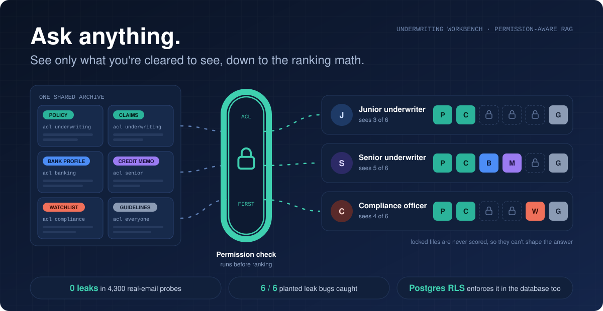
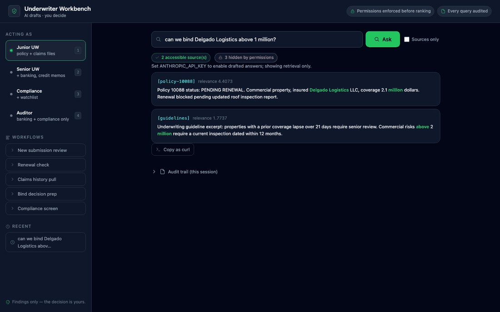
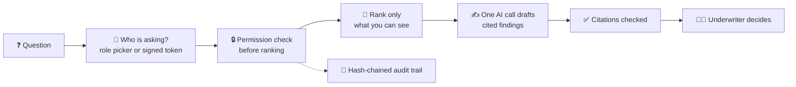

<div align="center">

# Permission-aware RAG: AI answers that only see what you're cleared to see



[](https://github.com/kgorle1111/permission-aware-rag/actions/workflows/ci.yml)
[](https://github.com/kgorle1111/permission-aware-rag/actions/workflows/platform.yml)


**The full technical tour: [README-technical.md](README-technical.md)**

</div>

## 🚦 The one-minute pitch

Every company wants to point AI at its documents. The catch is that not everyone is allowed
to read everything. An AI assistant that has indexed every file can leak the wrong one
through its answer, through a citation, or more quietly, through the way it ranks the
files you *are* allowed to see.

This project is an **underwriting workbench** that closes that leak at the root:

1. 🔒 **The permission check runs before search ranks anything.** Files you can't read are never scored.
2. 📐 **Ranking math only counts what you can see**, so a hidden file can't nudge the results.
3. ✍️ **One AI call drafts cited findings**, and every citation is checked against what was actually retrieved.
4. 🧾 **Every question lands on a tamper-evident audit trail**: who asked, what came back, what was withheld.

The AI drafts. The underwriter decides.

## 🎬 See it run



The same question, asked as a junior underwriter, a senior, a compliance officer and an
auditor. Sources appear and vanish with the role, and the UI says which data classes are
hidden and who to escalate to.

## 🧨 The problem we kept finding

The obvious fix is to search everything, then drop what the user can't see. **It still
leaks.** Hidden documents shift the relevance scores of the visible ones. That exact bug
was in this project's first version. An adversarial self-review found it, a failing test
reproduced it, and a regression test now proves scores are identical with and without a
hidden document.

Then we tested our own test. The original leak check was 20 hand-written cases, and it
reported zero leaks. So we planted six realistic leak bugs in copies of the retriever:
- no permission filter at all
- statistics computed over hidden files
- filtering after ranking
- `*` treated as "public" anywhere in a group name
- group names matched by prefix
- a results cache shared between users

**The hand-written check caught 1 of the 6.** A green test that has never been seen to fail
proves very little.

## 🧪 We measure, and we publish the "no"

So we built evidence that can fail:

| What we checked | Result |
|---|---|
| Leak probes on a frozen, hashed 210-document corpus (in-memory search) | **0 of 1,350** |
| The same probes against Postgres with row-level security | **0 of 1,350** |
| Planted leak bugs caught by the original hand-written check | 1 of 6 |
| Original planted leak bugs caught with the isolation check | **6 of 6** |
| Expanded gate, including OR-across-levels, flat-intersection and unscoped-cache faults | **9 of 9** |
| Real documents we didn't write: 600 EnronQA questions over 14,542 Enron emails, readers from sender/recipient headers | **0 of 4,300** unreadable chunks returned |
| Public benchmark (BEIR SciFact, NFCorpus, FiQA): retrieval matches published numbers; synthetic 4-tenant permission filter | bge-small within **0.001** of MTEB nDCG@10; **0 of 113,573** out-of-tenant results |
| Public leak benchmark we did not write ([ClearanceBench](evals/clearancebench/README.md)): overlapping ACLs, clearance levels, embargo windows, 600 principals; planted read-up and embargo bugs leak on 400/400 targeted probes | **0 of 38,400** result slots unreadable; revocation 50/50 clean; score identity 0/20 diffs |

In plain numbers: **0/1,350 leaks (95% upper bound 0.28%)**, and the hand-labeled gate
still holds at recall@4: 14/14 with zero leaks. The isolation check needs no labels. For
every role, the results over the full archive must be identical, scores included, to the
results over an archive holding only that role's files.

Kept on purpose: the corpus is synthetic, probes reuse the documents' own wording (so this
measures exact-wording recall, not semantic recall), and the probes aren't independent.

On real documents and questions we didn't write ([EnronQA](evals/enronqa/README.md), Enron mail
from the public FERC release; 15% of emails have two or more readers): **0/4,300 unreadable
chunks (95% upper bound 0.09%)** across owners, other recipients and non-readers, with owner
hit@4 of **91.5% (95% CI 89.0–93.5%)**. A planted off-by-one ACL bug leaks on 300/300 of the
same probes, so the check can see leaks. Citation validity needs a paid model run and is not
measured yet. The questions were machine-written from each email, so recall is optimistic.
[Full results](evals/results/2026-10-03-v2/table.md) · [EnronQA results](evals/results/2026-10-10-enronqa/table.md) · [BEIR results](evals/results/2026-10-12-beir/table.md) · [ClearanceBench results](evals/results/2026-10-16-clearancebench/table.md) · [pre-registered claims](ROADMAP.md#pre-registered-claims)

## 🔭 How it flows



## ✨ Why it's different

| | |
|---|---|
| 🔒 **Permission first, not filter after** | Forbidden text never enters ranking, so it can't shape the answer, the order or the citations. |
| 🐘 **The database enforces it too** | In the Postgres backend, row-level security returns only permitted rows, even if a query forgets its filter. |
| 🧪 **Tests that are proven to fail** | Planted leak bugs, a 3,071-mutant mutation gate, and docs that break the build when they drift from the code. |
| 🧾 **Receipts on every answer** | Latency and estimated cost per answer (about $0.002 on Claude Haiku 4.5), plus an audit log that detects edits. |

## 🆚 How this compares (sources checked 2026-10-19)

Permission-aware retrieval is a standard feature, not a new idea. What this project adds is **published,
reproducible leak measurements** and a check that is shown to catch planted bugs.

| | How permissions are enforced | Published leak measurement |
|---|---|---|
| [Microsoft 365 Copilot](https://learn.microsoft.com/microsoft-365-copilot/microsoft-365-copilot-privacy) | Surfaces only data the user has "at least view permissions" to | None we could find |
| [Glean](https://docs.glean.com/connectors/about) | Uses a permission snapshot mirrored during crawling; some connectors rely on scheduled crawls | None we could find |
| [Gemini Enterprise](https://docs.cloud.google.com/gemini/enterprise/docs/introduction-to-connectors-and-data-stores) | Connector ACLs; incremental sync "does not sync identity data", which needs a separate identity sync | None we could find |
| [Onyx](https://docs.onyx.app/security/architecture/access_controls) (open source, ~33k stars) | Per-document access is "only available in the Enterprise Edition" (source-available `ee/` licence) | None we could find |
| [OpenFGA](https://openfga.dev/docs/modeling/agents/rag-authorization) / [SpiceDB](https://github.com/authzed/langchain-spicedb) recipes | Pre-filter (look up accessible ids first) or post-filter after retrieval; you build the rest | None we could find |
| **This project** | Pre-filter before ranking, statistics over the visible set only, Postgres RLS, fail closed on permission drift | **0/4,300** on real email (EnronQA), **0/38,400** on [ClearanceBench](evals/clearancebench/README.md), with planted bugs that leak on 100% of targeted probes |

Where they win: connectors. They sync dozens of real sources; this project imports ACLs from a file, a Google
Drive connector (not yet run against a real tenant) or the API. "None we could find" means a search on 2026-10-19 turned up no published
leak-rate numbers; it does not mean none exist.

## 🧑‍💼 What this shows, if you're hiring

- **Security-minded AI engineering:** permission-aware retrieval, a prompt-injection boundary, citation verification and a written [threat model](docs/THREAT_MODEL.md) where each row names its test.
- **Evals before opinions:** pre-registered claims, confidence intervals, and negative results published next to the positive ones.
- **Production engineering:** a FastAPI service in [`platform/`](platform/README.md) with RS256/JWKS identity, Google Drive permission sync, a non-root Docker image and container smoke tests in CI. Load-tested on a laptop: about 370–400 req/s per process on unique queries, 0 leaks in 166,546 results ([load test](evals/results/2026-10-12-load-test/table.md)).
- **Product judgment:** a [case file](CASE_FILE.md) with a risk register, an [integration map](INTEGRATION.md) for a real underwriting shop, and a [roadmap](ROADMAP.md) that lists what we chose *not* to build.

## 🛠️ How it's engineered

- **Two layers.** A reference core in Python stdlib only (~600 readable lines, no dependencies), plus [`platform/`](platform/README.md), the same design as a deployable service on FastAPI, Qdrant, SQLAlchemy and PyJWT.
- **Two search backends.** BM25 in memory, or pgvector on Postgres with row-level security. Both run the leak gates in CI.
- **775 platform tests at 98.96% branch coverage**, with a 96% floor enforced in CI.
- **A blocking mutation gate.** 3,071 mutants: every survivor is either killed by a test or pinned as a reviewed equivalent with a written reason.
- **Fresh independent tests and review** caught audit privacy and prompt-boundary gaps;
  [repairs, preregistration and mutation limits](docs/INDEPENDENT_VERIFICATION.md) are documented.
  Four manual faults cover selected decorated code omitted by mutmut; coverage is finite.
- **Docs that can't drift.** Tests fail if a [decision](docs/DECISIONS.md), threat row or roadmap entry cites a test that no longer exists, or if this README's numbers stop matching a fresh eval run.
- **LLM hygiene:** one structured, grounded call; prompt caching on the static system prompt; graceful fallback to retrieval-only when the model is unavailable.

## 🚀 Try it in 60 seconds

[Open the live AWS demo](https://permission-rag-demo.b9hphyfz7skjm.us-east-2.cs.amazonlightsail.com/) — synthetic documents, predefined demo roles,
and retrieval-only answers. Use synthetic questions; demo role selection is not
real-user authentication. Audit history is ephemeral across container replacement.
[Hosting details and removal instructions](deploy/aws/README.md).

[](https://render.com/deploy?repo=https://github.com/kgorle1111/permission-aware-rag)
&nbsp;one-click free-tier deploy, or run it locally (no install step):

```bash
git clone https://github.com/kgorle1111/permission-aware-rag && cd permission-aware-rag/app
python3 run_evals.py                # the leak gate: 20 cases | recall@4: 14/14 | leaks: 0
SHOW_DENIED=1 python3 underwriter_server.py 8421  # open http://127.0.0.1:8421 (SHOW_DENIED=1: show the hidden-chunk count)
```

Switch roles with keys `1`–`4` and re-ask the same question. Set `ANTHROPIC_API_KEY` to turn
on drafted answers; without it, the workbench runs retrieval-only.

**The full platform** (FastAPI + Qdrant + signed JWTs + permission sync) in one command, with Docker:

```bash
git clone https://github.com/kgorle1111/permission-aware-rag && cd permission-aware-rag/platform
DEMO_MODE=1 docker compose up --build   # healthy ~15 s after the build; open http://127.0.0.1:8090
```

Pick an identity button in the UI and ask "what are the salary bands?". HR gets the salary bands, the
board gets executive compensation, engineering and guests get nothing. `DEMO_MODE=1` mints development
tokens and is for local evaluation only; without it the API accepts only tokens from your own IdP
(`JWKS_URL`). One container: the API with Qdrant in embedded (local) mode and SQLite; data and keys live in
the `rag-data` volume (`docker compose down -v` deletes them). The same thing from the command line:

```bash
TOKEN=$(curl -s http://127.0.0.1:8090/demo/tokens | python3 -c 'import json,sys; print(json.load(sys.stdin)["bob (hr)"])')
curl -s http://127.0.0.1:8090/query -H "Authorization: Bearer $TOKEN" -H 'Content-Type: application/json' \
  -d '{"query": "what are the salary bands?"}'
```

## 📏 Where it breaks (measured 2026-10-19)

The **platform** (FastAPI + Qdrant + SQLite) on one process, closed-loop load with unique queries, so every request
misses the cache. Each row is 60 s (30 s from 100 users up).

| Concurrent users | req/s | p50 | p95 | p99 | Errors / fail-closed | Leaks |
|---|---|---|---|---|---|---|
| 1 | 436 | 2 ms | 3 ms | 3 ms | 0 / 0 | 0 / 15,592 |
| 10 | 455 | 8 ms | 69 ms | 258 ms | 0 / 0 | 0 / 18,164 |
| 50 | 458 | 72 ms | 259 ms | 788 ms | 0 / 0 | 0 / 18,151 |
| 100 | 445 | 186 ms | 380 ms | 918 ms | 0 / 0 | 0 / 8,729 |
| 200 | 425 | 438 ms | 615 ms | 1.2 s | 0 / 0 | 0 / 8,376 |
| **500** | **399** | **1.2 s** | **1.5 s** | **2.0 s** | 0 / 0 | 0 / 7,826 |

- **Break point:** p95 crosses 1 s between 200 and 500 concurrent users.
- **Why:** throughput is flat at about 400–450 req/s because one Python process saturates one core. Past that,
  requests queue: nothing errors, nothing fails closed, nothing leaks. The server process used about 180 MB.
- **Next step when needed:** a second worker plus shared state in Postgres. Add it when real p95 at peak passes 1 s.

The **live demo** image under Lightsail Nano limits (0.25 vCPU, 512 MB) holds about 150–250 req/s, with p95 409 ms at
50 users and 42 MB of memory. A viral day is a few concurrent users, well inside both.

How measured:
- Laptop (Apple M3 Max, load average 5–9), so treat every cell as noisy (about 2x).
- Keyless config: hash embedder, no LLM call, 12-chunk corpus. Retrieval cost grows with corpus size; LLM latency
  and cost are not in these numbers.
- Every returned result was checked against an independent ACL oracle.
- [Platform results](evals/results/2026-10-19-load-ceiling/table.md) ·
  [demo results](evals/results/2026-10-19-load-ceiling/workbench-nano.md) ·
  [how to reproduce](evals/load/README.md)

## 🧭 Honest limits

- **Not deployed at a real underwriting shop.** Leak and recall numbers come from real public data (EnronQA, BEIR), with permissions derived from email headers or synthetic tenants rather than a customer's live ACLs.
- **SQL injection on the app's database connection can't widen document access:** ingest is a separate role ([T13](docs/THREAT_MODEL.md)) and principals are HMAC-signed and verified inside Postgres ([T18](docs/THREAT_MODEL.md)). Every read goes through a database function that writes the audit row itself, so that connection can't skip or forge audit entries; it can still read audit metadata, which the app's audit view needs ([T19](docs/THREAT_MODEL.md)).
- **Answer quality is unmeasured.** Retrieval is measured on BEIR and EnronQA; drafted-answer and citation validity on real data need a paid model run that hasn't happened yet.
- **Cross-document reasoning isn't solved.** The AI could combine permitted files into a conclusion no single file supports. Citations and a human decision are the guard.
- **One host.** Audit tail deletion is caught by an external checkpoint on one host; several hosts need a shared anchor ([T12](docs/THREAT_MODEL.md)). The rate limiter and spend cap are per host too.

## 🗺️ What's next

- Drafted-answer and citation-validity eval on EnronQA (needs a paid model run)
- Multi-host shared state: rate limiter, spend cap and audit anchor in Postgres
- Health and metrics endpoints with a runbook
- A leak-test kit you can point at your own retriever

Everything else: [ROADMAP.md](ROADMAP.md).

## 📄 License

Apache License 2.0. See [LICENSE](LICENSE).

More measured results: [hierarchy](evals/results/2026-10-07-hierarchy/table.md) ·
[100k documents / 1.5M chunks](evals/results/2026-10-08-scale/table.md) ·
[permission sync](evals/results/2026-10-08-sync-optimized/table.md) · [load test](evals/results/2026-10-12-load-test/table.md) ·
[retriever adapter kit](evals/kit/README.md) · [interview walkthrough](docs/WALKTHROUGH.md)
